# Cortex Vault Engine (V6.0)

> Motor autônomo de ingestão, destilação semântica e manutenção de grafos para Obsidian Vault sincronizado via Google Drive Desktop + Android DriveSync, alimentado pelo SDK oficial Google Gemini (`@google/genai`).

---

## Arquitetura (V6.0)

```mermaid
flowchart LR
  DriveCloud["Google Drive / Apps Script Bridge"] --> Inbox["00_Inbox_Bruto (.md)"]
  Root["Raiz / inbox_chats"] --> Watch["Chokidar Polling + Active fs.readdir"]
  Inbox --> Watch
  Watch --> Queue["SerialPromiseQueue (obsidian-git)"]
  Queue --> Pool["KeyPool + Per-Key 404/RPD Cache"]
  Pool --> Gemini["Gemini Map-Reduce + Section-Aware Wiki-Fold"]
  Gemini --> Validate["Frontmatter & Write Validator (obsidian-mind)"]
  Validate --> Atomic["Atomic Write + Retry Backoff (obsidian-livesync)"]
  Atomic --> Tx["Transaction Snapshots + ledger.jsonl (claude-obsidian)"]
  Tx --> Hygiene["Active Hygiene + MOC + .base Dashboards"]
```



---

## Módulos Transplantados & Arquitetura Cognitiva

| Origem | Módulo / Conceito | Função no Cortex Engine (`src/`) |
|---|---|---|
| `obsidian-mind` | `atomic-write.ts`, `frontmatter.ts`, `wikilinks.ts`, `validate-write.ts` | Escrita atômica com arquivo temporário + validação estrutural/anti-truncamento + parser YAML seguro (`src/lib/`). |
| `obsidian-mind` | `memory-similarity.ts`, `memory-supersede.ts`, `memory-write.ts` | Detecção léxica de notas duplicadas/similares antes de `CREATE_NEW` + rastreabilidade de supersessão. |
| `claude-obsidian` | `transaction.py`, `lint_engine.py`, `wiki-fold`, `release-allowlist.json` | Ledger transacional (`ledger.jsonl`) com rollback, `Section-Aware Wiki-Fold` sem bypass de IA, geração automática de `00_Indice_Global_MOC.md` / `00_Dashboard_Principal.md` e auditoria `security-check.ts`. |
| `obsidian-skills` | `obsidian-markdown`, `.base` dashboards | Uso nativo de Callouts (`> [!abstract]`, `> [!tip]`, `> [!warning]`), Properties YAML, diagramas Mermaid e Bases (`00_Catalogo_Geral.base`, `Recentes.base`). |
| `obsidian-livesync` & `obsidian-git` | NFC normalization, retry `EBUSY/EPERM`, `SerialPromiseQueue` | Normalização Unicode NFC multiplataforma (Windows/Drive/Android), backoff exponencial contra locks do Google Drive e fila serial controlada. |

---

## Como Rodar Localmente

1. Configure suas chaves no arquivo `.env` usando `.env.example` como modelo:
   ```bash
   cp .env.example .env
   ```
2. Instale dependências, valide tipos, compile, execute os testes e audite segurança:
   ```bash
   npm install
   npm run typecheck
   npm test
   npm run security:check
   ```
3. Inicie o daemon:
   ```bash
   npm start
   ```

---

## Fronteira Produto-Cofre (Segurança Pré-Commit)

Este repositório Git reside **exclusivamente dentro de `.automacao/`** para nunca versionar notas pessoais do cofre nem objetos `.git` no Google Drive / celular. Antes de qualquer commit:

```bash
npm run security:check
```

O auditor verifica ausência de `.git` na raiz do cofre pai, regras obrigatórias do `.gitignore` e bloqueia chaves de API, logs, arquivos `.env`, `vault-index.json`, `ledger.jsonl`, `checkpoints/` e `processed_archive/`.
